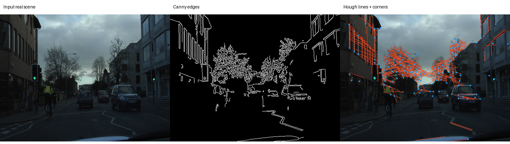
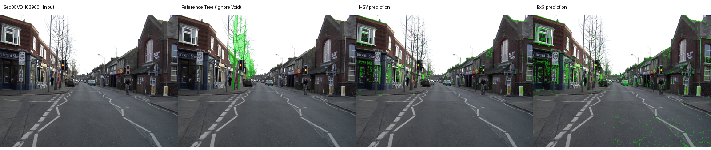
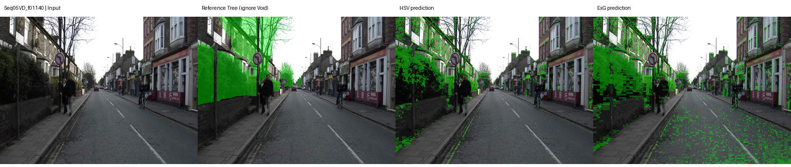
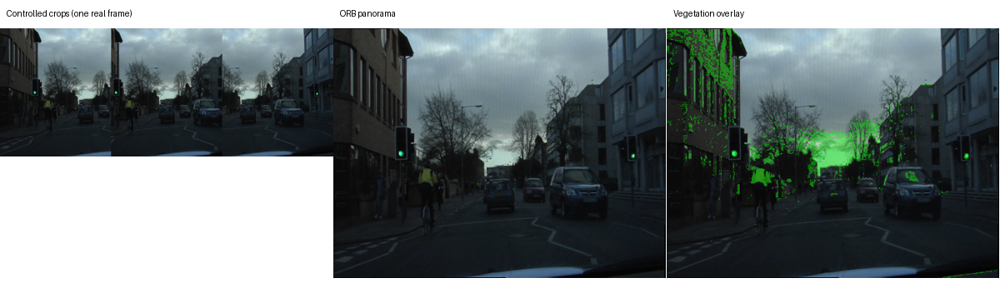

TRƯỜNG ĐẠI HỌC BÁCH KHOA — ĐHQG TP.HCM
KHOA KHOA HỌC VÀ KỸ THUẬT MÁY TÍNH

CO3057 — Xử lý ảnh số và Thị giác máy tính
Nhóm 02 · Lớp L01
Giảng viên: Thầy Võ Thanh Hùng

MSSV | Thành viên

2313026 | Hứa Thanh Tâm

2212612 | Hoàng Ngô Thiên Phúc

2310959 | Nguyễn Minh Hiếu

2433204 | Nguyễn Thị Kim Thanh

**Tóm tắt.** Xây dựng pipeline Python chạy local, kết hợp tiền xử lý RGB, phân tích hình học (Canny, Hough, corners và panorama ORB/SIFT) với hai baseline phân vùng theo màu HSV và Excess Green. Dữ liệu là ảnh đường phố thực có nhãn Tree trong CamVid. Cấu hình được chọn trên tập phát triển, sau đó đo trên các video sequence tách biệt. Số liệu và hình trong báo cáo được sinh từ lần chạy thật.

**Giới hạn diễn giải:** panorama được đánh giá bằng các crop chồng lấn từ cùng một ảnh thực; không tuyên bố đã đánh giá các góc chụp camera độc lập. Tree là lớp tham chiếu, không phải mọi loại thực vật.

Mã nguồn: https://github.com/hieunguyen2310959-boop/cv-btl3-green-scene

Thời điểm thực nghiệm UTC: 2026-10-30T00:25:25.996955+00:00

## 1. Bài toán và mức độ đáp ứng đề

Đầu vào là một ảnh đường phố hoặc danh sách ảnh cùng cảnh. Đầu ra gồm ảnh đã chuẩn hóa, biên/đường thẳng/điểm góc, panorama nếu ghép thành công, mask vùng cây xanh ứng viên, overlay và JSON kết quả. Ứng dụng hỗ trợ khảo sát thị giác ở mức prototype, không phục vụ quyết định quy hoạch thực tế.

Yêu cầu đề tổng hợp | Hiện thực / bằng chứng

3.1 Dữ liệu và tiền xử lý | CamVid có nguồn, SHA256; RGB, grayscale; resize giữ tỷ lệ

3.2 Hình học / cấu trúc | Canny + Hough + Shi–Tomasi; panorama ORB/SIFT, RANSAC homography

3.3 Nội dung / đối tượng | Phân vùng cơ bản bằng HSV và ExG; đối chiếu nhãn Tree

3.4 Trực quan hóa | Inputs, edges, lines/corners, panorama, mask, overlay, demo Streamlit

Mở rộng | So sánh 2 đặc trưng, 2 baseline; metric định lượng; test lỗi; demo local

### 1.1 Kết nối BTL1 và BTL2

BTL1 cung cấp nền tảng màu/xám, lọc và biến đổi ảnh; BTL2 cung cấp luồng đặc trưng → matching → RANSAC → warp/blend. BTL3 hiện thực lại các module độc lập bằng NumPy/OpenCV, không chép mã nguồn chưa có giấy phép từ hai repo cũ. Hai lỗi từng tái hiện được đưa thành điều kiện kiểm thử: identity warp phải giữ hàng/cột cuối; ghép thất bại phải trả failure thay vì dùng identity giả thành công.

### 1.2 Pipeline

**Ảnh nguồn → kiểm tra/resize → hình học → vùng hợp lệ → phân vùng → đánh giá → trực quan hóa.**
Nhánh một ảnh dùng edges/lines/corners. Nhánh nhiều ảnh thêm ORB/SIFT, matching, RANSAC và warp/blend. Mọi metric đều được ghi JSON; file lỗi không có ảnh thành công giả.

## 2. Dữ liệu, nhãn và thiết kế thực nghiệm

Tập | Số frame | Video sequence

Phát triển | 20 | 0006R0, 0016E5

Kiểm thử | 20 | 0001TP, Seq05VD

Nguồn ảnh/nhãn: CamVid, qua bản 12 lớp của SegNet-Tutorial [1–2]. Ảnh 480 × 360 pixel. Mỗi sequence lấy 10 frame cách đều theo danh sách nguồn, không chọn theo nhãn hoặc kết quả dự đoán. Split được xác định theo sequence trước khi chỉnh ngưỡng; không có sequence xuất hiện ở cả hai tập.

Nhãn dương: **Tree = 5**. Bỏ qua **Unlabelled = 11** khi tính metric. Cần phân biệt mask ảnh hợp lệ do warp với mask đánh giá: mask đánh giá còn loại pixel nhãn Void/ngoài GT. Dự đoán không đọc nhãn; chỉ hàm đánh giá được dùng nhãn tham chiếu.

Giữ manifest với đường dẫn, URL nguồn, commit upstream và SHA256 cho từng ảnh/nhãn. Không đưa toàn bộ dữ liệu gốc vào Git; script tải từ nguồn gốc và kiểm chứng bằng hash trước khi chạy.

### 2.1 Phân biệt hai loại đánh giá

**Phân vùng ảnh thực:** đánh giá HSV/ExG trực tiếp trên toàn bộ 20 frame test, không phụ thuộc ghép panorama thành công. Nhờ vậy không loại âm thầm các cảnh khó ghép khỏi bảng chính.

**Hình học có kiểm soát:** tạo 3 crop rộng 65% ảnh tại các vị trí x biết trước, cùng chiều cao. Đây là biến đổi tổng hợp của ảnh thực, cho phép đo lỗi chiếu góc độc lập với inlier RANSAC. Không có parallax, thay đổi phối cảnh lớn hoặc vật di chuyển giữa các view; vì vậy không dùng kết quả này để khẳng định độ tin cậy panorama camera thực.

Các frame cùng video vẫn tương quan; 20 frame test không tương đương 20 môi trường độc lập. Quy mô này phù hợp prototype môn học, chưa phải benchmark tổng quát.

## 3. Phân tích hình học và cấu trúc

Ảnh RGB được chuyển grayscale riêng cho đặc trưng; màu RGB vẫn được giữ cho phân vùng. Canny tìm biên với ngưỡng 60/150; HoughLinesP tìm đoạn thẳng với threshold 30, minLineLength 25 và maxLineGap 8. Shi–Tomasi cung cấp tối đa 150 corner để trực quan hóa.

Hình 1. Ảnh thực, biên Canny và đường thẳng/điểm góc. Không xem các đường này là mặt phẳng 3D.

### 3.1 Ghép panorama

So sánh ORB (descriptor nhị phân, Hamming) và SIFT (descriptor float, L2). Matching 2-nearest-neighbor với ratio test; RANSAC ước lượng homography nguồn → ảnh trước. Chuỗi homography được đưa về ảnh đầu, sau đó cộng translation để canvas chứa toàn bộ các view. Không thay homography lỗi bằng identity.

Warp ảnh và warp mặt nạ hỗ trợ độc lập; blending theo trọng số trên vùng giao. Pixel đen thật vẫn thuộc vùng hợp lệ, không suy valid mask từ RGB khác 0. Kiểm tra tính hữu hạn, ma trận suy biến, projective pole và giới hạn canvas trước khi cấp phát.

RMSE tái chiếu trên inlier là chỉ số fit nội bộ, không phải kiểm chứng độc lập. Trong crop experiment, sai số góc so với translation biết trước mới là đối chiếu hình học độc lập.

## 4. Phân vùng và metric

### 4.1 HSV

Chuyển RGB sang HSV theo OpenCV (H trong 0–179, S/V trong 0–255). Pixel được nhận nếu hue nằm trong khoảng cho trước, saturation đủ cao và value vượt ngưỡng. Phương pháp dễ giải thích nhưng nhạy với ánh sáng, cân bằng trắng, bóng râm và đồ vật sơn xanh.

### 4.2 Excess Green (ExG)

Chuẩn hóa màu theo tổng kênh: r = R/(R+G+B), g = G/(R+G+B), b = B/(R+G+B); pixel đen dùng mẫu số an toàn. Chỉ số **ExG = 2g − r − b**; so sánh với ngưỡng cố định. Đây là chỉ số ưu thế màu xanh, không phải xác suất có thực vật.

Cả hai baseline chỉ dự đoán trong valid mask. Mã có tùy chọn morphology và lọc component nhỏ; cấu hình đo chính không bật hậu xử lý để so sánh baseline màu rõ ràng.

### 4.3 Đánh giá

TP/FP/FN/TN đếm trên vùng valid và không Void. IoU = TP/(TP+FP+FN); precision = TP/(TP+FP); recall = TP/(TP+FN); F1 = 2TP/(2TP+FP+FN). Khi cả prediction và GT rỗng, IoU/F1 được quy ước bằng 1; nếu không có pixel đánh giá thì báo lỗi, không tạo NaN.

Macro IoU là trung bình theo frame; micro IoU tính từ tổng confusion counts. Báo thêm sai số tuyệt đối của tỷ lệ pixel trên vùng có nhãn; tỷ lệ output thường dùng toàn valid mask, nên không được lẫn hai mẫu số này.

### 4.4 Chọn tham số trên dev

Đã chạy 29 cấu hình trên 20 frame dev. Mỗi baseline chọn macro IoU cao nhất; sau đó ghi configs/selected.json và hash trước khi mở vòng đánh giá test. Không chọn lại ngưỡng theo test.

HSV: {&quot;method&quot;: &quot;hsv&quot;, &quot;h_min&quot;: 20, &quot;h_max&quot;: 85, &quot;s_min&quot;: 20, &quot;v_min&quot;: 20}; dev macro IoU = 0.1666

EXG: {&quot;method&quot;: &quot;exg&quot;, &quot;exg_min&quot;: 0.02}; dev macro IoU = 0.1562

## 5. Kết quả phân vùng trên ảnh thực

Baseline | Macro IoU | Micro IoU | Precision | Recall | F1

HSV | 0.1089 | 0.1208 | 0.3106 | 0.2180 | 0.1896

EXG | 0.1547 | 0.1770 | 0.2098 | 0.4964 | 0.2581

Toàn bộ frame test đều được tính trong bảng; không loại ảnh có ít cây hoặc lỗi màu. Baseline dùng cho demo/panorama được chọn theo dev, không chọn theo bảng test. HSV thắng trên dev nhưng ExG có IoU cao hơn trên test; vẫn giữ lựa chọn đã khóa để tránh chọn theo test. Cả hai IoU đều thấp: baseline màu chưa đủ để đo cây xanh đáng tin cậy.

HSV: tổng TP=75,969, FP=156,093, FN=396,881; sai số tuyệt đối tỷ lệ pixel trung bình = 9.59 điểm phần trăm.

EXG: tổng TP=246,940, FP=922,169, FN=225,910; sai số tuyệt đối tỷ lệ pixel trung bình = 22.90 điểm phần trăm.

Hình 2. Ví dụ IoU thấp nhất của baseline được chọn theo dev; lấy sau đánh giá để minh họa lỗi, không loại khỏi tổng hợp.

Hình 3. Ví dụ IoU cao nhất; nhãn Tree tham chiếu và hai prediction. Chênh lệch màu/ánh sáng gây bỏ sót hoặc nhận nhầm.

Các overlay tô vùng được nhận, không xác nhận mọi vùng xanh là cây. Cần quan sát đồng thời GT và prediction; không kết luận chất lượng chỉ từ ảnh overlay dễ nhìn.

## 6. Kết quả hình học có kiểm soát

Đặc trưng | Thành công / thử | Lỗi góc TB (px) | Thời gian hình học TB (s)

ORB | 20 / 20 | 0.6986 | 0.4434

SIFT | 20 / 20 | 0.0301 | 0.2066

Một lượt đo trên cùng máy, OpenCV một thread; thời gian gồm phát hiện đặc trưng, matching, ước lượng, warp và blend. Không coi số đo này là benchmark tốc độ ổn định hay cam kết FPS. Sai số góc là trung bình tại 4 góc của mỗi view so với translation đã biết, bao gồm view neo.

Hình 4. Panorama ORB từ crop của một ảnh thực. Chỉ là controlled registration experiment.

Hình 5. Cùng đầu vào với SIFT; segmentation dùng cấu hình đã khóa từ dev.

### 6.1 Kiểm soát âm và thất bại

ORB — hai ảnh không texture: **failed**; lý do: insufficient features

SIFT — hai ảnh không texture: **failed**; lý do: insufficient features

Các ca này phải thất bại rõ ràng, không sinh ảnh giả thành công. Bộ test còn kiểm tra identity warp, pixel đen hợp lệ, canvas quá lớn và ma trận projective nguy hiểm. Thành công trên crop không thay thế thử nghiệm camera với parallax, đổi phối cảnh, phơi sáng hoặc đối tượng chuyển động.

## 7. Kết quả theo từng frame test

Frame | HSV IoU | HSV F1 | ExG IoU | ExG F1

0001TP_008550 | 0.1284 | 0.2276 | 0.1360 | 0.2394

0001TP_008760 | 0.0872 | 0.1604 | 0.2309 | 0.3751

0001TP_008970 | 0.1036 | 0.1878 | 0.2744 | 0.4307

0001TP_009150 | 0.1546 | 0.2678 | 0.2220 | 0.3633

0001TP_009360 | 0.1592 | 0.2747 | 0.2410 | 0.3884

0001TP_009570 | 0.1401 | 0.2458 | 0.2367 | 0.3828

0001TP_009780 | 0.0394 | 0.0759 | 0.0749 | 0.1394

0001TP_009960 | 0.0417 | 0.0800 | 0.1179 | 0.2110

0001TP_010170 | 0.0520 | 0.0988 | 0.0951 | 0.1737

0001TP_010380 | 0.0656 | 0.1231 | 0.1904 | 0.3200

Seq05VD_f00000 | 0.2110 | 0.3484 | 0.1960 | 0.3278

Seq05VD_f00570 | 0.0396 | 0.0762 | 0.0301 | 0.0584

Seq05VD_f01140 | 0.2852 | 0.4438 | 0.3163 | 0.4806

Seq05VD_f01710 | 0.1133 | 0.2036 | 0.1252 | 0.2225

Seq05VD_f02280 | 0.0507 | 0.0965 | 0.0573 | 0.1083

Seq05VD_f02820 | 0.0444 | 0.0850 | 0.0549 | 0.1040

Seq05VD_f03390 | 0.1744 | 0.2971 | 0.2104 | 0.3476

Seq05VD_f03960 | 0.0287 | 0.0558 | 0.0316 | 0.0613

Seq05VD_f04530 | 0.2054 | 0.3408 | 0.2102 | 0.3474

Seq05VD_f05100 | 0.0539 | 0.1023 | 0.0422 | 0.0810

CSV/JSON đầy đủ: reports/results/segmentation_per_scene.*. Chi tiết từng cặp match/inlier, thời gian và lỗi góc: reports/results/geometry_per_scene.json. Bảng này được tạo trực tiếp từ JSON cùng lần chạy; không sao chép số liệu từ báo cáo BTL2.

## 8. Tái lập, hạn chế và kết luận

### 8.1 Tái lập

Môi trường thực thi: Windows-11-10.0.26300-SP0; Python 3.13.0; OpenCV 5.0.0; NumPy 2.5.4. Seed = 2310959; OpenCV threads = 1.

Windows: setup.cmd → tải dữ liệu → test → chạy thực nghiệm → build báo cáo. README chứa lệnh đầy đủ, requirements-btl3.lock khóa phiên bản. Không cần Docker/GPU; không tải model hay gửi ảnh lên dịch vụ inference. Dữ liệu được tải lần đầu từ nguồn công khai.

Hash cấu hình khóa: 909874a620fb98e77f8d80391aba0ec3509c8d355877ad3d1d094bd0e822f0eb

### 8.2 Hạn chế

• Hai video sequence kiểm thử và các frame tương quan; chưa chứng minh khả năng tổng quát qua mùa, quốc gia hoặc camera.

• HSV/ExG là baseline màu: bỏ sót lá vàng/bóng râm, nhầm đồ vật xanh; Tree không bao phủ đầy đủ cỏ và các loại thực vật.

• Panorama chỉ đánh giá crop translation; cần bổ sung ảnh chụp độc lập để đánh giá parallax và robustness camera thực.

• Không suy diện tích địa lý từ tỷ lệ pixel; không có calibration camera/depth/scale.

### 8.3 Phân công bàn giao để nhóm xác nhận

Thành viên | Phần cần review, nắm vững và trình bày

Hứa Thanh Tâm | geometry.py; ORB/SIFT, matching, RANSAC, warp/blend

Hoàng Ngô Thiên Phúc | segmentation.py; HSV/ExG và failure cases

Nguyễn Minh Hiếu | dataset/split, evaluate.py, tests và thực nghiệm

Nguyễn Thị Kim Thanh | preprocess/runner, demo và tích hợp

Đây là phân công bàn giao đề xuất, không phải xác nhận các thành viên đã tự viết các module. Code và tài liệu có AI hỗ trợ; nhóm cần review, chạy lại, xác nhận đóng góp thực tế và tuân thủ quy định môn học.

**Kết luận:** prototype kết nối đủ bốn nhóm yêu cầu cốt lõi bằng pipeline chạy được, có nguồn dữ liệu/nhãn, so sánh baseline và bằng chứng thực nghiệm. Giá trị chính là khả năng tái lập và diễn giải, không phải độ chính xác semantic hoặc khả năng panorama ngoài thực địa đã được chứng minh.

## Tài liệu tham khảo và nguồn gốc

[1] Cambridge-driving Labeled Video Database (CamVid). University of Cambridge. https://mi.eng.cam.ac.uk/research/projects/VideoRec/CamVid/

[2] Alex Kendall et al. SegNet-Tutorial, dữ liệu CamVid 12 lớp và mapping Tree/Unlabelled. https://github.com/alexgkendall/SegNet-Tutorial ; commit bb68b64e72cb004b3ed927fee0f5624dd8097498. Không sử dụng trọng số SegNet.

[3] OpenCV documentation: ORB, SIFT, feature matching, findHomography, warpPerspective, Canny, HoughLinesP và color conversions. https://docs.opencv.org/ ; phiên bản chạy ghi trong mục 8.

[4] Báo cáo và repository BTL1 của nhóm: thanhkimnguyen/CO3057_NHOM_02, commit bb863828c1325210728e047197b74bfb6f0ea7d0. Tham khảo khái niệm, không đóng gói mã nguồn vào repo BTL3.

[5] Báo cáo và repository BTL2 của nhóm: FRGTama/BTLCV2, commit 4c5f7ca61f45ecbc78701841c2a8ab4316c30659. Tham khảo pipeline và các ca lỗi đã tái hiện.

[6] Đề Bài tập tổng hợp môn CO3057 do người dùng cung cấp: CV-project-tonghop (1).pdf, mục 3–5. Không đưa nguyên tài liệu môn học lên repo công khai.

### Đối chiếu artifact

Artifact | Vai trò

data/manifest.json | URL, split, nhãn, SHA256 nguồn

configs/selected.json | Ngưỡng đã khóa trước đánh giá test

reports/results/summary.json | Tổng hợp đo thật và môi trường

reports/results/development_trials.json | Toàn bộ cấu hình thử trên dev

reports/Bao-cao-BTL3-CV.pdf | Báo cáo được build từ kết quả

docs/VERIFICATION_BTL3.md | Bằng chứng kiểm thử/chạy lại

THIRD_PARTY.md | Nguồn tham khảo và phạm vi tái sử dụng

Dữ liệu gốc thuộc tác giả CamVid; script tải trực tiếp phục vụ học thuật. Không tự gán giấy phép MIT cho ảnh/nhãn. Hình trích trong báo cáo phục vụ phân tích thực nghiệm, có nguồn dẫn. Nếu cần phân phối lại dữ liệu ngoài phạm vi này, phải kiểm tra điều khoản từ chủ sở hữu.